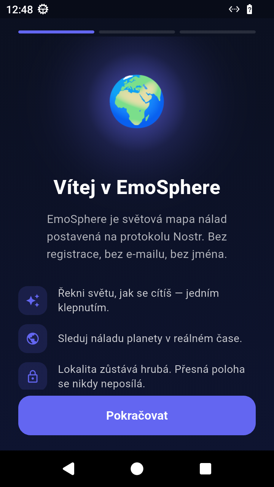
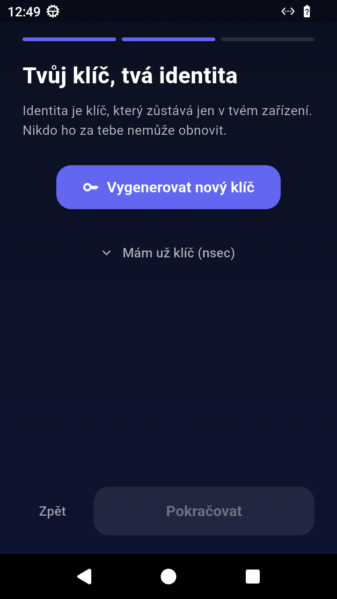
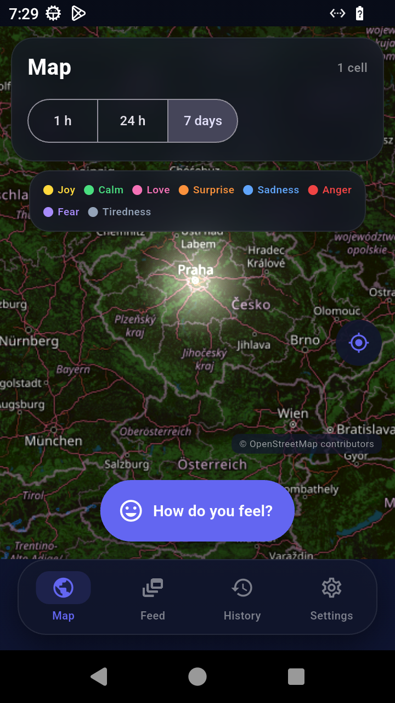
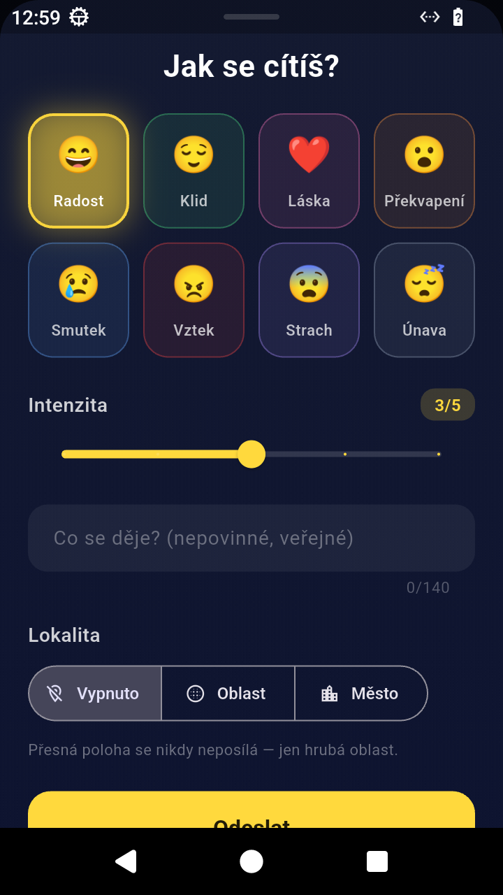
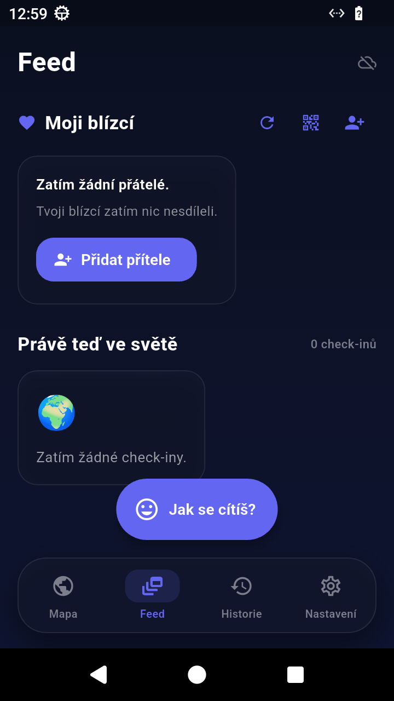
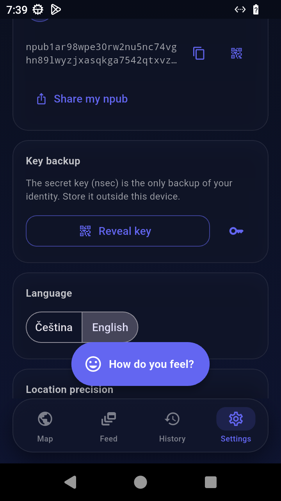
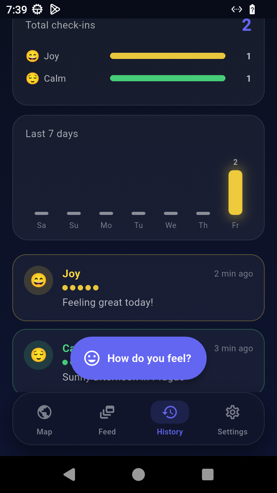

# EmoSphere

> **Share how you feel with the world.** A global mood map built on [Nostr](https://nostr.com).

[](https://github.com/Vojta01/emosphere/actions/workflows/ci.yml)
[](https://github.com/Vojta01/emosphere/actions/workflows/deploy-pages.yml)

🌐 **Web / PWA:** https://vojta01.github.io/emosphere/ &nbsp;·&nbsp; 📱 **Android APK:** [download the latest release](https://github.com/Vojta01/emosphere/releases/latest)

## What is EmoSphere?

EmoSphere lets people around the world share their current emotion — anonymously
and without registration — and watch a live, glowing map of how the planet feels
right now.

- **No accounts.** Your identity is a Nostr key generated on your device.
- **Privacy first.** Location is coarse only (area / city) or off. No emails, no names.
- **Decentralized.** Check-ins are signed Nostr events published to public relays —
  no central server owns your data.

## Screenshots

<table>
  <tr>
    <td align="center"><br><sub>Onboarding — welcome</sub></td>
    <td align="center"><br><sub>Generate or import your Nostr key</sub></td>
    <td align="center"><br><sub>World mood map — live emotion heat</sub></td>
  </tr>
  <tr>
    <td align="center"><br><sub>Check-in — emotion, intensity, note</sub></td>
    <td align="center"><br><sub>Feed — my people &amp; the world</sub></td>
    <td align="center"><br><sub>Settings — profile, key, language</sub></td>
  </tr>
  <tr>
    <td align="center"><br><sub>History — my check-ins</sub></td>
    <td></td>
    <td></td>
  </tr>
</table>

The screenshots show the English UI — the app ships in English and Czech.

## Get the app

| Platform | How to install |
|---|---|
| **Android** | Download the `emosphere-<version>.apk` from the [latest release](https://github.com/Vojta01/emosphere/releases/latest), allow installation from unknown sources and open the file. Android 7.0+ (API 24+). |
| **iPhone / iPad** | Open https://vojta01.github.io/emosphere/ in **Safari** → *Share* → **Add to Home Screen**. It then behaves like a native app — no App Store, no Mac needed. |
| **Web** | https://vojta01.github.io/emosphere/ — an installable PWA, works in any modern browser. |

## Features

- 🌍 **World mood map** — heat cells where colour = dominant emotion and glow = activity; windows 1 h / 24 h / 7 days; tap a cell for the breakdown. Friend cells are highlighted.
- ✍️ **Check-in** — pick 1 of 8 emotions, set intensity 1–5, add an optional public note (max 140 chars), choose location precision (off / area / city).
- 👥 **Friends** — follow people by npub, share your own npub (copy or QR code); names and avatars come from their Nostr profiles (kind 0).
- 📜 **History** — your check-ins on a timeline, plus simple statistics (per emotion, per day).
- 🗑️ **My data** — delete your check-ins from the relays (NIP-09) and from the device.
- 🔐 **Key** — generated on your device; back it up (nsec, QR) or import an existing key; reveal it again in Settings.
- 🌐 **Languages** — Czech & English.
- 🌙 **Design** — dark, premium, glass-style UI with emotion-coloured glow.

## The eight emotions

| Emotion | Colour |
|---------|--------|
| Joy | #FFD93D |
| Calm | #4ADE80 |
| Love | #F472B6 |
| Surprise | #FB923C |
| Sadness | #60A5FA |
| Anger | #EF4444 |
| Fear | #A78BFA |
| Tiredness | #94A3B8 |

Each check-in carries one emotion plus an intensity from 1 to 5.

## Tech

- **[Flutter](https://flutter.dev) (Dart)** — one codebase for Android and the web/PWA.
- **[Nostr](https://nostr.com)** — check-ins are custom kind `1074` events (`#t=emosphere`) signed on the device and published to public relays; `dart_nostr` handles relay I/O. There is no backend.
- **[flutter_map](https://pub.dev/packages/flutter_map)** + OpenStreetMap tiles for the mood map.
- **Storage** — the key lives in `flutter_secure_storage` on Android and in `localStorage` on the web; preferences in `shared_preferences`.
- **CI/CD** — GitHub Actions: analyze + tests + web build on every push ([ci.yml](.github/workflows/ci.yml)), GitHub Pages deployment ([deploy-pages.yml](.github/workflows/deploy-pages.yml)) and an on-demand / release APK build ([android-build.yml](.github/workflows/android-build.yml)).

## Development

```bash
flutter pub get
flutter run                                       # on a device / emulator
flutter analyze                                   # static analysis
flutter test                                      # unit + widget tests
flutter build apk --release                       # Android APK
flutter build web --base-href /emosphere/ --pwa-strategy offline-first   # PWA
```

Repo layout: `lib/core` (models, Nostr service, geo, storage, i18n) · `lib/screens` · `lib/widgets` · `lib/theme`.

More docs: [docs/SPEC.md](docs/SPEC.md) · [docs/CORE-API.md](docs/CORE-API.md) · [docs/BRANDING.md](docs/BRANDING.md).

## Status

**v0.5.1 — released 24 Oct 2026.** All MVP features are in: onboarding + key backup, check-in, world mood map with a continuous emotion heat layer and a **time machine** (timeline slider, 8-second replay, 1 h / 6 h / 24 h replay windows), feed, friends, history, settings, Czech/English UI with a **first-run language picker** (English-first unless the system is Czech) — shipped as a release-signed Android APK and an installable PWA. 219 unit/widget tests are green, `flutter analyze` is clean and CI is green on `main`.

Recently shipped: the heat map (v0.3.0), publish resilience — retries and stale-socket recovery (v0.3.1), heat cells centred on the actual check-ins rather than the coarse cell middle (v0.3.2), emotion-matched afterglow animations with 160 reflective quotes (v0.4.0), the map time machine (v0.5.0) and a first-run CZ/EN language picker with locale-aware defaults plus an English social preview for the PWA (v0.5.1).

Remaining work:

- **Anti-spam** — check-ins are open by design; per-key aggregation and rate limits are planned.
- **PWA** — Flutter currently registers the service worker from its bootstrap; switch to an app-owned registration once upstream lands ([flutter#156910](https://github.com/flutter/flutter/issues/156910)).
- **iOS** — no native iOS app; the PWA is the iOS path (by design).
- **Play Store** — the APK is release-signed for sideloading; a Play Store listing is not set up.

## License

MIT — see [LICENSE](LICENSE).
